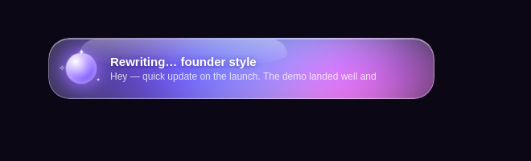

<div align="center">


# revoice

**Select text. Hit a hotkey. It's rewritten in your voice — right where you typed it.**

[](https://github.com/jdanjohnson/Revoice-AI-Rewriting-Tool/actions/workflows/ci.yml)
[](LICENSE)


[](CONTRIBUTING.md)



</div>

You're already paying for AI (ChatGPT, Claude, Kimi, or you run a free local model). So why pay for *another* subscription just to clean up your messages? revoice turns the AI you already have into a system-wide rewrite button on your Mac.

It works anywhere you can select text — Slack, Mail, Notion, your browser, your editor. No app switching, no copy-paste dance, no new subscription.

## The magic

1. Select any text, in any app.
2. Press **⌃⇧Z** (Ctrl+Shift+Z).
3. Watch the rewrite stream into a shiny liquid-glass popup.
4. Press **⏎** to swap it in — or **esc** to keep your original. Nothing is pasted until you say so.

That's it. Your clipboard is untouched, your cursor stays where it was, and the popup tells you which AI did the work.

**Before** (what you typed):

> hey just wanted to check in and see if u had a chance to look at the thing i sent over, no rush but lmk when u can

**After** (one keystroke later):

> Hey, have you had a look at that document I sent? Let me know when you get to it.

## Pick your vibe

| Hotkey | What you get |
|--------|--------------|
| **⌃⇧Z** | Your voice (tone auto-matched to the app — Slack gets casual, Mail gets professional) |
| **⌃⇧1** | Founder — direct, decisive |
| **⌃⇧2** | Casual — relaxed, friendly |
| **⌃⇧3** | Professional — polished business |
| **⌃⇧4** | Concise — about half the words |
| **⌃⇧E** | Tell it what to do ("make it shorter", "make it warmer", anything) |
| **⌃⇧R** | **One-press reply** — uses the screen and selected text as context, then previews a draft |
| **⌃⇧P** | Turn selected rough notes into a clear prompt for an AI tool |
| **⌃⇧A** | Answer a selected question, or enter a question if nothing is selected |

Don't like the rewrite? Press **R** to regenerate or **1–4** to instantly re-run it in another style, right from the preview.

## Context-aware replies

Click into a reply box and press **⌃⇧R**. Revoice captures the active window, uses any selected text as rough notes, gathers the context you have configured, and shows a draft in the normal preview. There is no notes dialog. The preview never sends the reply: press **⏎** to paste it yourself, or **esc** to keep the original.

Revoice can use local files in `~/.revoice/context/`:

- `about-me.md` — stable background about you, up to 3,000 characters.
- `notes.md` — durable preferences and reminders; the last 2,000 characters are used. Use **✍️ → Remember…** or `revoice --remember "text"` to append a dated note.
- `zoey.md` — a local cache of your Zoey context card, refreshed when stale.

When a Zo token is configured, reply, ask, and prompt modes can also look up up to three matching contact cards and read calendar free/busy information when a meeting is being discussed. Calendar access is read-only. Optional Goldfish screen activity is also read-only and best-effort. The context is sent to the configured rewrite backend as part of the user message; leave those features unconfigured or set `REVOICE_CONTEXT=off` to disable context gathering.

Example setup for `~/.revoice/env` (replace placeholders with your own values):

```sh
REVOICE_ZO_TOKEN=YOUR_ZO_TOKEN
REVOICE_CALENDARS=person@example.com
REVOICE_TZ=America/New_York
REVOICE_WORK_HOURS=9-18
```

Revoice's Zo allowlist permits only file reads, directory listing, and the approved Google Calendar read tools. **It never sends email and never creates or books calendar events.** Revoice only drafts and previews text; nothing is sent or booked automatically.

**⌃⇧P** turns selected rough notes into a structured prompt. **⌃⇧A** answers a selected question, or opens a question prompt if nothing is selected. Both can use the configured context and use the same preview; nothing is sent until you choose what to do with the text yourself.

For screenshot support, allow **Screen Recording** for Hammerspoon in macOS System Settings. Screenshots are only taken when you press the reply hotkey or floating button.

## It actually sounds like *you*

This is the part that makes revoice different:

- **You own the prompt.** The entire rewrite prompt is a plain text file (`~/.revoice/prompt.txt`). Edit it like a doc. Make it yours.
- **Feed it your writing.** Paste a few of your real messages into `~/.revoice/voice-samples.txt` and every rewrite imitates *your* style — not generic AI-speak.
- **No AI slop.** Two anti-slop rule packs ship by default (goodbye "I hope this finds you well" and "game-changing"). Drop in your own rules as simple markdown files.
- **It learns.** Reject a rewrite and it's remembered as a "don't write like this" example next time.
- **It flags what it wasn't sure about.** If your draft could be read two ways ("them" = legal or the client?), the preview shows a little ⚑ chip so you catch it before you paste.

## Get started (2 minutes)

```bash
curl -fsSL https://raw.githubusercontent.com/jdanjohnson/Revoice-AI-Rewriting-Tool/main/install.sh | bash
```

(Prefer to see what you're running? `git clone https://github.com/jdanjohnson/Revoice-AI-Rewriting-Tool.git revoice && cd revoice && ./install.sh` does the same thing.) Later, `revoice --update` pulls the latest version and re-installs.

Then open Hammerspoon, grant it **Accessibility** permission (System Settings → Privacy & Security → Accessibility), and click **Reload Config**.

**Hook up an AI** (any one of these):

- **ChatGPT (GPT-6 Astra)** — already have Codex? You're done. (If not: `npm i -g @openai/codex`, run `codex` once to sign in with your ChatGPT account.) Want Astra to go first? Put `REWRITE_BACKEND=codex,claude,kimi,ollama` in `~/.revoice/env`.
- **Claude** — already have Claude Code? You're done. (If not: `npm i -g @anthropic-ai/claude-code`, run `claude` once to sign in.)
- **OpenAI API** — want Astra in ~3 seconds with the text streaming in live, and don't mind paying per token? Drop `OPENAI_API_KEY=sk-...` into `~/.revoice/env` (model `gpt-6-astra`). Codex above is the free-with-your-subscription path; this is the fast one.
- **Kimi** (or any OpenAI-compatible API) — drop `KIMI_API_KEY=sk-...` into `~/.revoice/env`.
- **Totally free & private** — `brew install ollama && ollama pull llama3.2:3b` and everything runs on your Mac. Nothing leaves your machine.

Switch between them anytime from the ✍️ menu-bar icon → **Backend** (no config files needed), and if a hotkey ever misbehaves, ✍️ → **Run doctor** tells you why.

Select some text, press **⌃⇧Z**, and enjoy.

## Why Revoice exists

Revoice is a small, configurable tool for drafting and rewriting text with the AI tools you already use. Keep your prompts, writing samples, and optional context files on your own machine and choose which backend receives each request.

## Want the nerdy details?

Architecture, CLI usage, every config file and env var, security notes, and how the prompt is assembled: **[docs/TECHNICAL.md](docs/TECHNICAL.md)**.

Want to hack on it? The whole tool is three files — see **[CONTRIBUTING.md](CONTRIBUTING.md)**.

## Requirements & fine print

- macOS (hotkeys use [Hammerspoon](https://www.hammerspoon.org/); the installer sets it up). The CLI itself runs anywhere Node ≥18 does.
- Unless you use the local Ollama backend, selected text (and, in Reply mode, a screenshot of the frontmost window) is sent to your AI provider — don't hotkey your passwords.

## License

[MIT](LICENSE) — free to use, share, and remix.

---

<div align="center">

If revoice makes your writing faster, a ⭐ helps other people find it.

</div>
